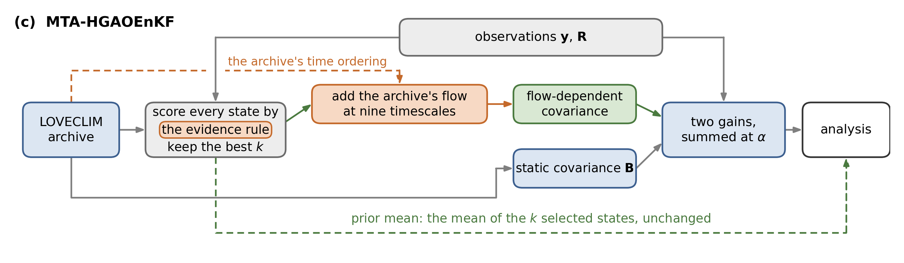

# Sparse paleoclimate field reconstruction

**Multiscale Tendency Augmentation for a Hybrid Gain Analog Offline EnKF in Paleoclimate Data
Assimilation: Spatially Complete Reconstruction of Dansgaard–Oeschger Temperature Fields across
Marine Isotope Stage 3**

MSc Computing individual project, Department of Computing, Imperial College London, 2026.\
Author: Evgeni Galinov Georgiev. Supervisor: Dr. Sibo Cheng.

This repository holds the code for the thesis: the estimators it compares, the experiments
that score them, the MIS3 reconstruction, and the notebook that draws every figure and table
in the report.

> **Results pending the full re-run.** Every number, figure and operating point that depends
> on a run of the pipeline is marked as pending below.

## Overview

Pollen records from Marine Isotope Stage 3 (MIS3, about 59 to 28 ka) give MTCO and MTWA at 187
scattered sites ([Liu et al., 2026](https://doi.org/10.5194/cp-22-205-2026)). A LOVECLIM
transient simulation ([Menviel et al., 2014](https://doi.org/10.5194/cp-10-63-2014)) gives
complete fields on a 32 × 64 grid, but no observation constrains them. Data assimilation
combines the two. Here it is hard for two reasons: the proxy network reaches only 113 of the
2,048 grid cells, and the prior is a single run of 804 states, 25 years apart, whose neighbours
are near-duplicates (median lag-1 autocorrelation 0.95).

The hybrid gain analog offline EnKF (HGAOEnKF) of
[Sun et al. (2024)](https://doi.org/10.1029/2022MS003414) builds its prior ensemble from the
archive states that best match the observations. In an archive this redundant, selection
returns near-identical members and the analog covariance collapses. **MTA-HGAOEnKF** makes two
changes:

- **Evidence rule.** Candidates are ranked by their marginal likelihood,
  $`p(\mathbf{y} \mid j) = \mathcal{N}(\mathbf{y};\ \mathbf{H}\mathbf{x}_j,\ \kappa\mathbf{H}\mathbf{B}\mathbf{H}^\top + \mathbf{R})`$,
  rather than by the R-weighted misfit, which is its κ = 0 case. The evidence scale κ is tuned.
- **Multiscale Tendency Augmentation (MTA).** Around each selected state, first differences of
  the archive at seven lags (200 to 3,200 yr) and second differences at two (400 and 1,600 yr)
  are added to the analog covariance. A tuned share w of the covariance's whitened
  observation-space variance is moved from the member deviations to these tendency rows, so
  MTA reallocates variance rather than inflating it.

The method is then run on the real pollen network at every age to give a spatially complete
MTCO and MTWA reanalysis of 49,175 to 29,100 BP, with a posterior variance at every cell.

## Method

<p align="center">
  
</p>

*Orange marks what MTA-HGAOEnKF adds to HGAOEnKF.*

With $`\mathbf{X}'`$ the deviations of the $`k`$ selected members, $`\mathbf{T}`$ the centred
difference blocks stacked with each block put on the amplitude of the 400 yr first difference,
and $`t_X`$, $`t_T`$ their traces in whitened observation space at the observed cells, the
analog covariance is

```math
\mathbf{Z} = \begin{bmatrix} \sqrt{1 - w}\,\mathbf{X}' \\ \sqrt{w\, t_X / t_T}\,\mathbf{T} \end{bmatrix},
\qquad
\mathbf{P} = \frac{\mathbf{Z}^\top \mathbf{Z}}{k - 1}.
```

The trace of $`\mathbf{R}^{-1/2}\mathbf{H}\mathbf{P}\mathbf{H}^\top\mathbf{R}^{-1/2}`$ is the
same at every w. At w = 0 the estimator is HGAOEnKF with the evidence rule; at w = 1 only the
tendency directions remain, about the same analog mean. Everything else is the HGAOEnKF update:
one prior mean, and an analog and a static gain summed at weight α. Both covariances share one
taper.

Each lane uses the observation model its observations call for. On the snapshot lane a
pseudo-proxy sits on the truth's own cell and age, so R is each sample's stated error. On the
time-series lane a sample is read at its own dating-block centre, so R adds a temporal term for
a sample assimilated at another age. On the real-proxy withholding lane and in the product, R
also adds a spatial term for a point proxy standing in for its 5.625° cell.

## Results

Each estimator is scored on three evaluation lanes, which answer different questions:

| Lane | Prior | Truth | Observations |
|---|---|---|---|
| Pseudo-proxy snapshot | older half of the archive | each younger-half state | a real network's geometry, read from the truth, with site noise |
| Pseudo-proxy time series | older half | the younger half, in sequence | each sample read at its own dating-block centre |
| Real-proxy site withholding | all 804 states | withheld pollen | real pollen in five site folds, each predicted once from the other four |

Only the snapshot lane tunes the covariance taper and the analog parameters. The time-series
lane inherits them and selects the background amplitude c on its own selection arm. The
withholding lane inherits them too and reports every c.

*Held-out skill and calibration for 3DVar, HGAOEnKF, evidence-only HGAOEnKF and MTA-HGAOEnKF on
the three lanes: pending the full re-run.*

## The reconstruction

The reconstruction is written to `outputs/product/` as `reconstruction_fields.npz` with the
`reconstruction_config.json` that produced it. It holds one analysis per archive age, 49,175 to
29,100 BP at 25-year steps, for both channels on the 32 × 64 grid, at five background
amplitudes c ∈ {0.3, 1, 2, 5, 10}. The amplitudes are published side by side because nothing
without a truth can choose between them. The configuration is MTA-HGAOEnKF at the snapshot
lane's selected k, α, κ, w and taper, with the stack above and every one of the 804 states as
the prior; the config records each of them. *The selected values are pending the full re-run.*

| Array | Shape | Units | Contents |
|---|---|---|---|
| `ages` | (804,) | yr BP | age of each analysis, ascending |
| `lats`, `lons` | (32,), (64,) | ° | cell centres |
| `b_scales` | (5,) | | the published amplitudes c |
| `mean_anom` | (5, 804, 2, 32, 64) | °C | posterior mean anomaly, by amplitude, age, channel, cell |
| `post_var` | (5, 804, 2, 32, 64) | °C² | posterior variance (not a standard deviation) |
| `post_cross_var` | (5, 804, 32, 64) | °C² | posterior MTCO–MTWA covariance at each cell |
| `clim_mean` | (2, 32, 64) | °C | the climatology the anomalies are taken about |
| `prior_var` | (2, 32, 64) | °C² | diagonal of the regularised background covariance B |
| `n_obs` | (804,) | | observation rows assimilated at each age |
| `n_sites` | (804,) | | distinct sites assimilated at each age |
| `prior_only` | (804,) | | true at the 36 ages with no pollen |
| `safe_valid` | (32, 64) | | cells kept by the prior (all of them on this grid) |
| `prior_mean_anom` | (804, 2, 32, 64) | °C | the analog ensemble mean each analysis updated |
| `analog_index` | (804, k) | | archive indices of the k members selected at each age |
| `chi2_bg`, `chi2_an` | (804,), (5, 804) | | innovation and analysis residual, whitened by R |
| `desroziers_r` | (5, 804) | | Desroziers ratio; 1 where the assumed R matches the residuals |
| `innov_r_mean` | (804,) | °C² | mean observation-error variance at each age |

Channel 0 is MTCO and channel 1 is MTWA. To read absolute temperatures:

```python
import numpy as np

z = np.load("reconstruction_fields.npz")
c = list(z["b_scales"]).index(5.0)
mtco = z["clim_mean"][0] + z["mean_anom"][c, :, 0]   # (804, 32, 64), °C
mtco_sd = np.sqrt(z["post_var"][c, :, 0])
```

The 36 ages from 29,975 to 29,100 BP have no pollen. There the field is the climatology and
the variance is the prior's, scaled by c. *What the lanes say about reading the rest of the
field (calibration, the timescales resolved, skill against distance from the network) is
pending the full re-run.*

## Getting started

Tested with Python 3.12 on macOS. The `Makefile` expects a virtual environment at `./paleo`;
pass `PY=<interpreter>` to `make` to use another.

```bash
git clone https://github.com/evgeni-g-georgiev/sparse_paleoclimate_field_reconstruction.git
cd sparse_paleoclimate_field_reconstruction
python3.12 -m venv paleo
paleo/bin/pip install -r requirements.txt
```

Both inputs come from one CC-BY 4.0 Zenodo record, [Liu (2026)](https://doi.org/10.5281/zenodo.18218890),
a 1.1 GB archive:

```bash
mkdir -p data
curl -L -o data/liu2026.zip "https://zenodo.org/records/18218890/files/Data%20and%20codes.zip?download=1"
unzip -p data/liu2026.zip "Data and codes/Input data/LOVECLIM/LOVECLIM_seasonal_T_binned.csv" > data/Prior.csv
unzip -p data/liu2026.zip "Data and codes/Output data/ACER reconstructions/Reconstruction/recon_climate with CO2 correction and age adjusted.csv" > data/Observation.csv
make check
```

The archive also holds an `Output data_Quercus removed/` copy under the same file name; use the
path above. The expected MD5 checksums are `495f7b61a65142af943be8c55eaea8c8` for `Prior.csv`
and `34e330b7a63f84db50dcd6448b41c4fb` for `Observation.csv`. The prior is parsed once and
cached under `data/cache/`.

## Reproducing the results

```bash
make test      # unit and integration tests, a few seconds
make smoke     # every stage at reduced size into outputs/_smoke, then the notebook, 5 to 8 min
make all       # the full pipeline
make figures   # re-run the results notebook from the stored outputs
```

`make all` runs the stages `scripts/00` to `04` in order and then executes
`notebooks/final_results.ipynb`, which reads the stored outputs, runs no estimator, and writes
every figure, table and quoted number in the report. [`scripts/README.md`](scripts/README.md)
gives what each stage inherits and how to re-run one on its own. Setting `PALEORECO_OUTPUTS`
points every stage and the notebook at another outputs root. BLAS is held to one thread: the
work is thousands of small eigendecompositions, which run several times slower when split
across cores.

## Where things are

```
paleoreco/
  assim/        estimators, observation model, evaluation lanes, grids, reconstruction
  data/         prior cube loader and the age axis
  eval/         skill (rRMSE, CE, SSIM), calibration (CRPS, RCRV) and the metric rows
  report/       figure and table helpers for the results notebook
scripts/        pipeline stages 00 to 04
notebooks/      final_results.ipynb, the source of every report figure and table
tests/          unit and integration tests
docs/figures/   figures used in this README
```

| In the thesis | In the code |
|---|---|
| 3DVar, gain form and whitened amplitude sweep | `paleoreco/assim/threedvar.py`, `ensrf.py` |
| Localisation L, shrinkage λ, channel coupling γ | `paleoreco/assim/priors.py` |
| HGAOEnKF hybrid gain; MTA stack and tendency share | `paleoreco/assim/hgaoenkf.py` |
| Misfit, correlation and evidence selection rules | `paleoreco/assim/analog.py` |
| Spatial and temporal observation error | `paleoreco/assim/observations.py`, `background.py` |
| The three evaluation lanes | `paleoreco/assim/lanes.py` |
| Tuning grids and inheritance between lanes | `paleoreco/assim/experiments.py` |
| The reconstruction | `paleoreco/assim/reconstruction.py`, `scripts/04_product.py` |

## Data

Both inputs are from [Liu (2026)](https://doi.org/10.5281/zenodo.18218890), released under
CC-BY 4.0: the pollen-based reconstructions of
[Liu et al. (2026)](https://doi.org/10.5194/cp-22-205-2026), and the LOVECLIM MIS3 transient
simulation of [Menviel et al. (2014)](https://doi.org/10.5194/cp-10-63-2014) as binned in that
record. Neither file is redistributed here.

## Citation

GitHub's "Cite this repository" button reads [`CITATION.cff`](CITATION.cff). In BibTeX:

```bibtex
@mastersthesis{georgiev2026mta,
  author = {Georgiev, Evgeni Galinov},
  title  = {Multiscale Tendency Augmentation for a Hybrid Gain Analog Offline {EnKF} in
            Paleoclimate Data Assimilation: Spatially Complete Reconstruction of
            {Dansgaard--Oeschger} Temperature Fields across {Marine Isotope Stage 3}},
  school = {Imperial College London},
  type   = {{MSc} thesis},
  year   = {2026},
  url    = {https://github.com/evgeni-g-georgiev/sparse_paleoclimate_field_reconstruction}
}
```

## Licence

Copyright © 2026 Evgeni Galinov Georgiev. All rights reserved; see [`LICENSE`](LICENSE).

## Acknowledgements

Thanks to Dr Sibo Cheng for supervising the project, and to Dr Mengmeng Liu for providing the
data and answering questions about it.
